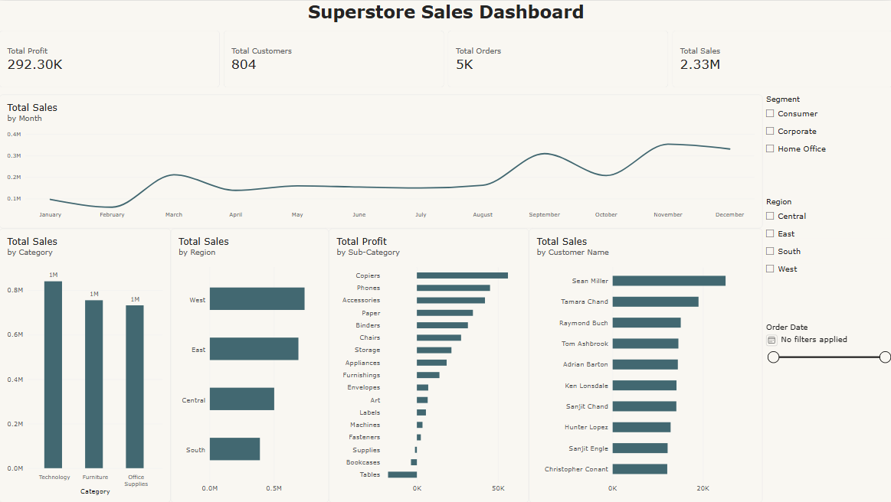

# Superstore Sales Analytics

End-to-end sales analysis of the Superstore dataset using **SQL Server**, **Python** and **Power BI**: from data quality checks to an interactive dashboard.

## Objective
Understand sales and profit performance, identify the best and worst performing categories, regions and customers, and present the results in a clear dashboard.

## Tools
- **SQL Server**: data quality checks and cleaning (`Sales_Analytics` database)
- **Python** (pandas, matplotlib): exploratory analysis, KPIs and report generation
- **Power BI Desktop**: interactive dashboard

## Project Workflow
1. **Data quality checks (SQL Server):** checked the raw `Superstore_Sales` table for missing values, duplicates and inconsistencies, then exported the cleaned data to `Superstore_Cleaned.csv`.
2. **Exploratory analysis (Python):**
   - `monthly_test.py`: monthly sales trend
   - `region_analysis.py`: sales by region
   - `customer_analysis.py`: customer summary, top customers, sales vs profit
   - `sales_analytics.py`: KPI calculations
   - `final_report.py`: generates an HTML and Excel report with charts and summary tables
3. **Dashboard (Power BI):** built KPI cards, trend and breakdown charts, and slicers.

## Key KPIs
| KPI | Value |
|---|---|
| Total Sales | 2.33M |
| Total Profit | 292.30K |
| Profit Margin | ~12.5% |
| Total Customers | 804 |
| Total Orders | ~5K |

## Dashboard Features
- KPI cards: Total Sales, Total Profit, Total Orders, Total Customers
- Monthly sales trend (line chart)
- Sales by Category and by Region
- Profit by Sub-Category
- Top 10 customers by sales
- Slicers: Segment, Region, Order Date

## Key Insights
- **Technology** is the top category by sales.
- **West** is the top region by sales.
- **Copiers** is the most profitable sub-category; **Tables** is loss-making and worth reviewing for pricing and discounts.
- Sales are lower early in the year and rise toward the end, with peaks around September and November.
- Revenue is spread across many customers; no single customer dominates.

## Repository Structure
```
Superstore_Cleaned.csv     cleaned dataset
monthly_test.py            monthly sales chart
region_analysis.py         region analysis
customer_analysis.py       customer analysis
sales_analytics.py         KPIs and analysis
final_report.py            HTML / Excel report generator
Superstore_Dashboard.pbix  Power BI dashboard
Superstore_Dashboard.pdf   dashboard export
```

## How to Run
```bash
pip install pandas matplotlib openpyxl
python final_report.py
```
The report is saved in the `report/` folder. Open `report/final_report.html` in a browser.

## Author
Your Name | [valmikiganesha](#) | [valmikiganesh](#)
